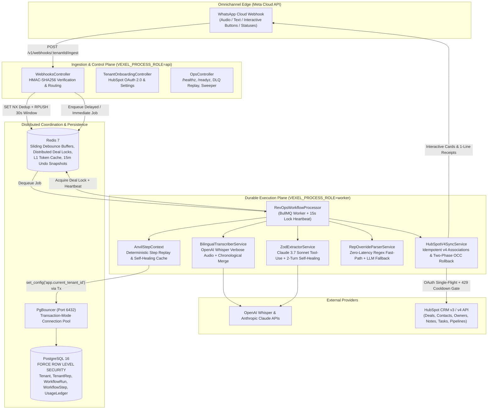
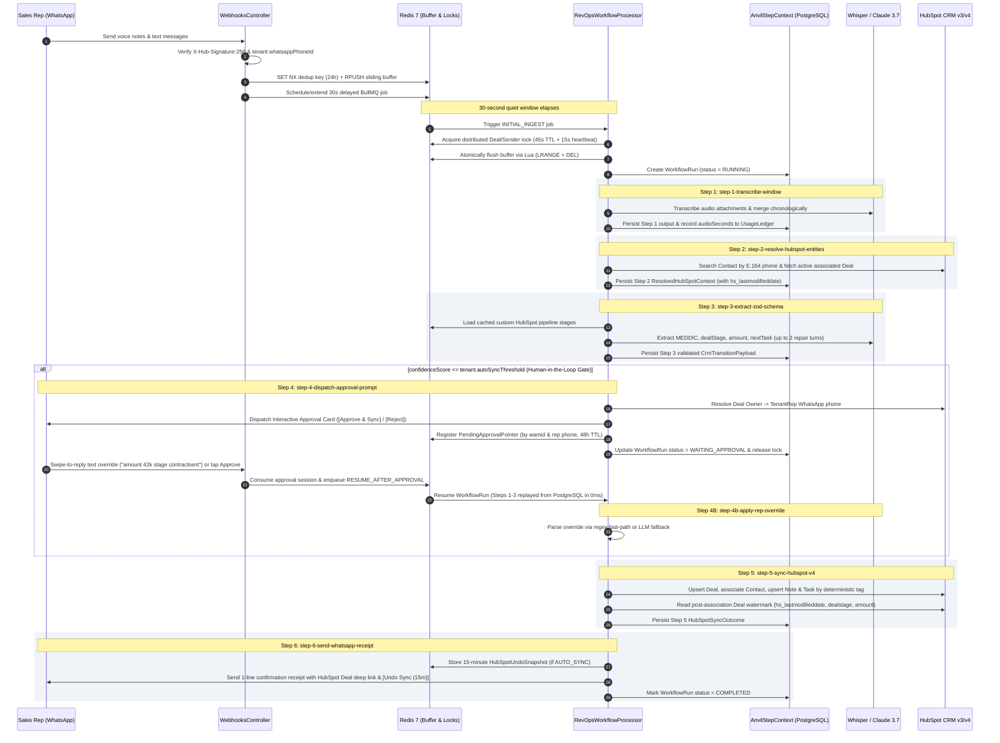
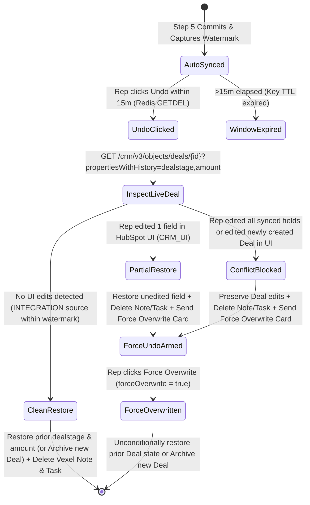
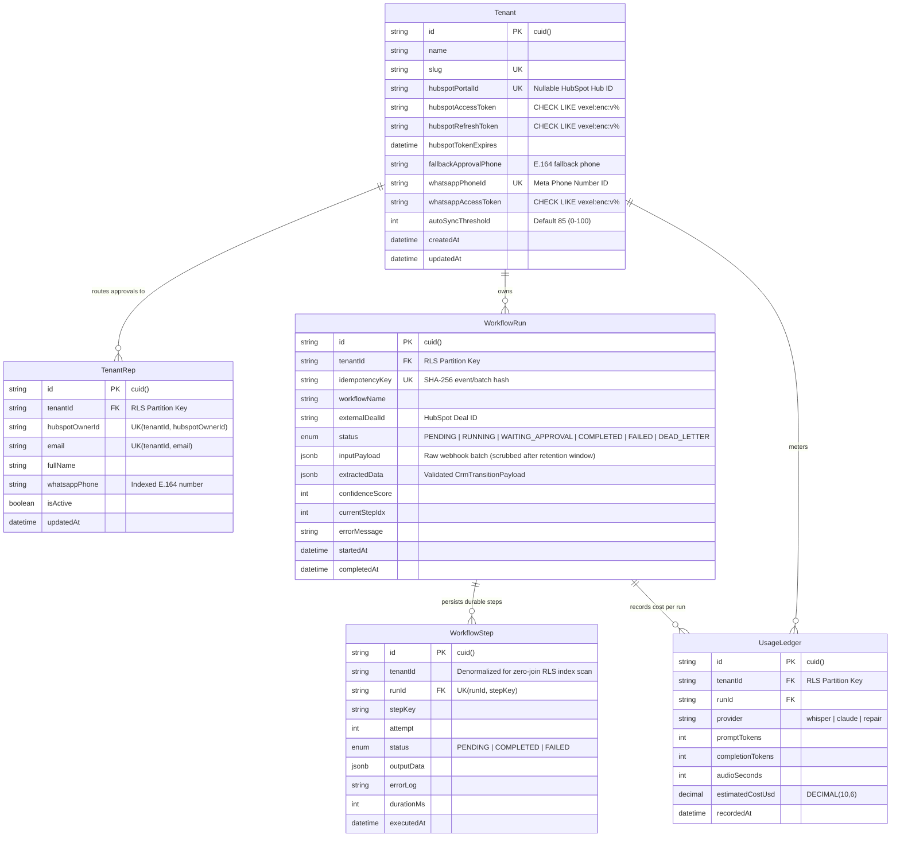

# Vexel — Autonomous Omnichannel-to-HubSpot RevOps Execution Engine

Vexel is a multi-tenant, event-driven Revenue Operations (RevOps) execution engine that transforms unstructured bilingual (Arabic/English) WhatsApp text and voice note conversations into validated, idempotent HubSpot CRM v4 state transitions.

Built on a durable step-execution architecture (`@vexel/anvil-engine`), Vexel enforces hardware-grade envelope encryption (`AES-256-GCM`) for OAuth credentials at rest, PostgreSQL Row-Level Security (RLS) pinned over PgBouncer transaction-mode connections, human-in-the-loop WhatsApp interactive approvals, conversational sales rep overrides, and a 15-minute Two-Phase Optimistic Concurrency Control (OCC) rollback saga.

---

## Table of Contents

1. [System Architecture](#1-system-architecture)
2. [Monorepo Package Topology](#2-monorepo-package-topology)
3. [End-to-End Execution Pipeline (Anvil Durable Steps)](#3-end-to-end-execution-pipeline-anvil-durable-steps)
4. [Two-Phase Optimistic Concurrency Control (OCC) & 15-Minute Undo Saga](#4-two-phase-optimistic-concurrency-control-occ--15-minute-undo-saga)
5. [Data Model & PostgreSQL Row-Level Security (RLS)](#5-data-model--postgresql-row-level-security-rls)
6. [Cryptographic Envelope Specification](#6-cryptographic-envelope-specification)
7. [Redis Keyspace & Lua Concurrency Primitives](#7-redis-keyspace--lua-concurrency-primitives)
8. [HTTP API Reference](#8-http-api-reference)
9. [Environment Configuration](#9-environment-configuration)
10. [Local Development, Docker Deployment & Testing](#10-local-development-docker-deployment--testing)

---

## 1. System Architecture



---

## 2. Monorepo Package Topology

| Package / App | Path | Responsibility |
| :--- | :--- | :--- |
| `worker-api` | `apps/worker-api` | NestJS HTTP ingestion server and BullMQ worker host (`WebhooksController`, `TenantOnboardingController`, `OpsController`, `RevOpsWorkflowProcessor`, `VexelLockService`). |
| `@vexel/anvil-engine` | `packages/anvil-engine` | Durable step execution runner (`AnvilStepContext`). Executes external HTTP I/O outside database transactions, caches step outputs in `WorkflowStep`, and supports targeted step cache eviction (`invalidateSteps`). |
| `@vexel/crm-hubspot` | `packages/crm-hubspot` | Envelope encryption (`EnvelopeCryptoService`), single-flight OAuth manager (`HubSpotTokenManagerService`), rate-limit-aware HTTP client (`HubSpotHttpClient`), entity resolver (`HubSpotEntityResolverService`), owner router (`HubSpotOwnerResolverService`), WhatsApp interactive approval service (`WhatsAppApprovalService`), and HubSpot v4 idempotent sync + OCC rollback engine (`HubSpotV4SyncService`). |
| `@vexel/extractor` | `packages/extractor` | Bilingual Whisper audio transcription (`BilingualTranscriberService`), dynamic HubSpot pipeline stage caching (`PipelineStageCacheService`), strict Zod v4 schema builder (`buildTenantCrmTransitionSchema`), self-healing Claude extractor (`ZodExtractorService`), conversational rep override parser (`RepOverrideParserService`), and token/audio cost metering (`UsageMeterService`). |
| `@vexel/database` | `packages/database` | Prisma 7 schema, PostgreSQL migrations, `AsyncLocalStorage` tenant context (`TenantContext`), transaction-pinned RLS extension (`$withTenantTransaction`), and plaintext token write guards (`vexelEncryptedTokenGuard`). |

---

## 3. End-to-End Execution Pipeline (Anvil Durable Steps)



### Durable Step Registry

| Step Key | Input Source | External I/O | Self-Healing / Failure Behavior |
| :--- | :--- | :--- | :--- |
| `step-1-transcribe-window` | `WorkflowRun.inputPayload.messages` | Meta Media API + OpenAI Whisper (`whisper-1` verbose JSON) | Retries via BullMQ exponential backoff; logs audio seconds to `UsageLedger`. |
| `step-2-resolve-hubspot-entities` | `MergedTranscriptBundle.senderPhone` | HubSpot `/crm/v3/objects/contacts/search` + v4 Deal associations | Prioritizes Deal `hubspot_owner_id` over Contact `hubspot_owner_id`. |
| `step-3-extract-zod-schema` | Transcript + `ResolvedHubSpotContext` + `TenantDealStage[]` | Anthropic Claude (`claude-3-7-sonnet-20250219`) forced `tool_use` | Stage 1 deterministic sanitizer (`sanitizeRawToolInput`) + Stage 2 multi-turn Zod diagnostic feedback loop (max 2 repair attempts). |
| `step-4-dispatch-approval-prompt` | `CrmTransitionPayload` (when `confidenceScore <= autoSyncThreshold`) | Meta Graph API `/messages` (Interactive Button Card) | Routes to Deal owner's linked WhatsApp or `tenant.fallbackApprovalPhone` with fallback reason banner. |
| `step-4b-apply-rep-override` | `rawRepOverrideText` + existing `CrmTransitionPayload` | Zero-token regex parser (<1ms) or Claude fallback | Normalizes shorthand multipliers (`42k`, `1.5m`), Arabic numerals, currencies, and fuzzy stage names. |
| `step-5-sync-hubspot-v4` | Final `CrmTransitionPayload` + `ResolvedHubSpotContext` | HubSpot v3/v4 Deals, Notes, Tasks, Associations | Deduplicates Notes/Tasks via `[vexel_run_id:{runId}]` tag. On `StaleDealStageError`, invalidates Redis stage cache and evicts Steps 3–5 from PostgreSQL. |
| `step-6-send-whatsapp-receipt` | `HubSpotSyncOutcome` | Meta Graph API `/messages` | Non-blocking: receipt dispatch errors are logged as warnings without failing the committed CRM sync. |
| `step-7-rollback-hubspot-sync` | `HubSpotUndoSnapshot` (`ROLLBACK_AUTO_SYNC` / `FORCE_ROLLBACK_AUTO_SYNC`) | HubSpot v3 Deals (`propertiesWithHistory`) + Notes/Tasks archive | Executes Two-Phase OCC verification before restoring deal fields or archiving newly created deals. |

---

## 4. Two-Phase Optimistic Concurrency Control (OCC) & 15-Minute Undo Saga

Creating and associating a Timeline Note or Follow-Up Task in HubSpot automatically advances the parent Deal's `hs_lastmodifieddate` by 500ms–2,500ms. To prevent false-positive concurrency conflicts while protecting manual edits made by humans in the HubSpot UI during the 15-minute Undo window, Vexel implements Two-Phase Optimistic Concurrency Control:

1. **Phase 1 — Post-Association Watermark Capture**: At the conclusion of `syncTransitionIdempotently()`, after the Deal upsert, Contact association, Note creation, and Task creation have all settled, Vexel reads the Deal's authoritative `hs_lastmodifieddate` (`syncedDealLastModifiedMs`), `dealstage` (`committedDealStage`), and `amount` (`committedAmount`), storing them inside the 15-minute Redis undo snapshot (`vexel:undo:{tenantId}:{runId}`).
2. **Phase 2 — Pre-Rollback CAS Inspection (`propertiesWithHistory`)**: When a rep clicks `[Undo Sync (15m)]`, Vexel atomically pops the snapshot via Redis `GETDEL` (verifying sender phone ownership) and fetches the live Deal with `propertiesWithHistory=dealstage,amount`.



### Concurrency Decision Matrix

| Scenario During 15m Window | `hs_lastmodifieddate` | `propertiesWithHistory` Source | Deal Rollback Action (`dealAction`) | Vexel Note & Task Action | Follow-Up Card |
| :--- | :--- | :--- | :--- | :--- | :--- |
| No concurrent edits | `<= syncedDealLastModifiedMs + 3000ms` | `INTEGRATION` | `RESTORED_PREVIOUS_STATE` or `ARCHIVED_NEW_DEAL` | Archived (`DELETE`) | Final confirmation notice |
| Rep edits `dealstage` in HubSpot UI | `> watermark` | `CRM_UI` on `dealstage` | `PARTIAL_RESTORE_SKIPPED_EDITED_FIELDS` (reverts `amount`, keeps UI `dealstage`) | Archived (`DELETE`) | Interactive `[Force Overwrite]` button |
| Rep edits `dealstage` and `amount` in UI | `> watermark` | `CRM_UI` on both fields | `CONFLICT_PRESERVED_MANUAL_EDIT` | Archived (`DELETE`) | Interactive `[Force Overwrite]` button |
| Rep edits newly created Deal in UI | `> watermark` | `CRM_UI` on any property | `CONFLICT_PRESERVED_MANUAL_EDIT` (blocks Deal deletion) | Archived (`DELETE`) | Interactive `[Force Overwrite]` button |
| Rep clicks `[Force Overwrite]` | Any | Any (`forceOverwrite: true`) | `FORCE_OVERWRITTEN` | Already archived | Final force-overwrite confirmation |

---

## 5. Data Model & PostgreSQL Row-Level Security (RLS)



### Multi-Tenant Isolation Guarantees

1. **PostgreSQL `FORCE ROW LEVEL SECURITY`**: Enabled on `Tenant`, `TenantRep`, `WorkflowRun`, `WorkflowStep`, and `UsageLedger`. Every policy enforces:
   ```sql
   NULLIF(current_setting('app.bypass_rls', true), '') = 'on'
   OR "tenantId" = NULLIF(current_setting('app.current_tenant_id', true), '')
   ```
2. **PgBouncer Transaction-Mode Pinning (`$withTenantTransaction`)**: Because PgBouncer reuses backend PostgreSQL connections across transactions, session-level `SET` statements are unsafe. `@vexel/database` wraps every query/mutation in an interactive transaction that executes `SELECT set_config('app.current_tenant_id', $1, true)` (`is_local = true`), scoping the tenant context strictly to that transaction.
3. **Application-Layer Prisma Guard (`tenant-rls.guard.ts`)**: Automatically injects `tenantId` from `TenantContext` (`AsyncLocalStorage`) into all `where` and `data` clauses, throwing `MissingTenantContextError` if a query runs outside an active `TenantContext` or `CrossTenantAccessError` if a record belongs to another tenant.

---

## 6. Cryptographic Envelope Specification

All sensitive third-party credentials (`Tenant.hubspotAccessToken`, `Tenant.hubspotRefreshToken`, `Tenant.whatsappAccessToken`) are sealed prior to database or Redis persistence using `EnvelopeCryptoService`:

```text
vexel:enc:<kekVersion>:<wrappedDekBundleBase64Url>:<cipherBundleBase64Url>
```

| Segment | Byte Layout | Cryptographic Construction |
| :--- | :--- | :--- |
| `kekVersion` | ASCII (`v1`, `v2`, ...) | Identifies the 256-bit Master Key Encryption Key (`VEXEL_KEK_V1`) from the environment keyring. |
| `wrappedDekBundle` | `IV (12B) \|\| AuthTag (16B) \|\| WrappedDEK (32B)` | One-time 256-bit random Data Encryption Key (DEK) encrypted with `AES-256-GCM` under the Master KEK. |
| `cipherBundle` | `IV (12B) \|\| AuthTag (16B) \|\| Ciphertext (NB)` | Token plaintext encrypted with `AES-256-GCM` under the one-time DEK. |
| GCM AAD | UTF-8(`${tenantId}:${purpose}`) | Additional Authenticated Data bound to both the DEK wrap and payload cipher (`hubspot_access_token`, `hubspot_refresh_token`, or `whatsapp_access_token`), preventing cross-tenant or cross-column ciphertext transplantation. |

Defense-in-depth enforcement:
- **Application Guard**: `encryptedTokenGuardExtension` and `tokenEnvelopeGuard` inspect every Prisma write operation and throw `UnencryptedTokenWriteError` if a non-null token does not match `^vexel:enc:v\d+:[A-Za-z0-9_-]{36,}:[A-Za-z0-9_-]{36,}$`.
- **Database Constraint**: PostgreSQL `CHECK` constraints (`tenant_hubspot_access_token_encrypted_chk`, `tenant_hubspot_refresh_token_encrypted_chk`, `tenant_whatsapp_access_token_encrypted_chk`) reject any SQL write that does not begin with `vexel:enc:v`.

---

## 7. Redis Keyspace & Lua Concurrency Primitives

| Key Pattern | Type | TTL | Purpose |
| :--- | :--- | :--- | :--- |
| `vexel:dedup:{tenantId}:{sha256}` | `STRING` | `24h` | Edge webhook deduplication (`SET ... EX 86400 NX`). |
| `vexel:buf:{tenantId}:{senderPhone}` | `LIST` | `1h` | Sliding 30-second message buffer; atomically drained via Lua (`LRANGE 0 -1` + `DEL`). |
| `vexel:lock:{tenantId}:{entityKey}` | `STRING` | `45s` | Distributed mutex lock per sender/deal; extended every 15s and released strictly via owner-checked Lua scripts. |
| `vexel:hs:token:{tenantId}` | `STRING` | `expiresIn - 120s` | L1 cache storing the `vexel:enc:...` sealed HubSpot access token envelope. |
| `vexel:hs:oauth-lock:{tenantId}` | `STRING` | `15s` | Single-flight leader mutex preventing concurrent OAuth refresh stampedes. |
| `vexel:hs:cooldown:{tenantId}` | `STRING` | Dynamic (`retryAfterMs`) | Tenant-wide rate-limit backpressure gate armed on HTTP `429` or when remaining burst `<= 2`. |
| `vexel:pipelines:{tenantId}:{pipelineId}` | `STRING` | `6h` | Cached custom HubSpot deal stages and win probabilities. |
| `vexel:owners:{tenantId}` | `HASH` | `12h` | Maps `hubspotOwnerId` -> `CachedOwnerRecord` (email, name, linked WhatsApp E.164 phone). |
| `vexel:rep-link-otp:{tenantId}:{e164Phone}` | `STRING` | `10m` | Stores SHA-256 OTP hash and attempt counter (max 5 attempts) for `/link` + `/verify` rep self-linking. |
| `vexel:wa:msg:{wamid}` | `STRING` | `48h` | Correlates swipe-to-reply WhatsApp message IDs to paused `WAITING_APPROVAL` runs. |
| `vexel:wa:rep:{tenantId}:{digits}` | `STRING` | `48h` | Correlates unquoted direct text replies from a sales rep's phone to their active `WAITING_APPROVAL` run. |
| `vexel:undo:{tenantId}:{runId}` | `STRING` | `15m` | Stores `HubSpotUndoSnapshot` with post-association OCC watermarks; popped atomically via `GETDEL`. |
| `vexel:force_undo:{tenantId}:{runId}` | `STRING` | `15m` | Armed when an OCC manual edit conflict is detected, enabling `[Force Overwrite]`. |

---

## 8. HTTP API Reference

### 8.1 Webhooks (`WebhooksController`)

| Method | Path | Auth | Description |
| :--- | :--- | :--- | :--- |
| `GET` | `/v1/webhooks/:tenantId/ingest` | `hub.verify_token` (`META_WEBHOOK_VERIFY_TOKEN`) | Meta WhatsApp webhook verification challenge endpoint. |
| `POST` | `/v1/webhooks/:tenantId/ingest` | `X-Hub-Signature-256` (`META_APP_SECRET`) | Primary omnichannel ingestion endpoint. Handles voice notes, text messages, `/link <email>`, `/verify <otp>`, conversational rep overrides, interactive buttons (`approve`, `reject`, `undo`, `force_undo`), and `statuses[]` delivery failure callbacks. |
| `POST` | `/v1/webhooks/approval-callback` | `x-vexel-api-key` (`VEXEL_INTERNAL_API_KEY`) | Programmatic approval/rejection callback to resume a `WAITING_APPROVAL` workflow run with optional `editedPatch`. |

### 8.2 Tenant Onboarding & Settings (`TenantOnboardingController`)

| Method | Path | Auth | Description |
| :--- | :--- | :--- | :--- |
| `GET` | `/v1/hubspot/install?tenantId=...` | Public OAuth Redirect | Redirects tenant admin to HubSpot OAuth 2.0 consent screen with CRM deals, contacts, owners, and timeline scopes. |
| `GET` | `/v1/hubspot/callback?code=...&state=...` | HubSpot OAuth Code | Exchanges authorization code, resolves `hubspotPortalId`, seals tokens with `EnvelopeCryptoService`, warms owner & stage caches, and registers nightly `sync-hubspot-owners` scheduler. |
| `POST` | `/v1/hubspot/disconnect` | `x-vexel-api-key` | Purges tenant HubSpot OAuth tokens, evicts Redis cache, and removes scheduled owner sync job. |
| `GET` | `/v1/tenants/:tenantId/settings` | `x-vexel-api-key` | Returns tenant configuration (`autoSyncThreshold`, `hubspotPortalId`, `whatsappPhoneId`, `fallbackApprovalPhone`, rep & run counts). |
| `POST` | `/v1/tenants/:tenantId/settings` | `x-vexel-api-key` | Updates tenant settings and optionally seals a per-tenant `rawWhatsAppToken`. |

### 8.3 Operations, Health & Dead-Letter Queue (`OpsController`)

| Method | Path | Auth | Description |
| :--- | :--- | :--- | :--- |
| `GET` | `/healthz` | None | Liveness probe returning process role (`api` \| `worker` \| `both`) and uptime. |
| `GET` | `/readyz` | None | Readiness probe verifying PostgreSQL (`SELECT 1`), Redis (`PING`), and BullMQ queue depth (`waiting`, `active`, `delayed`, `failed`). |
| `GET` | `/v1/ops/tenants/:tenantId/dlq` | `x-vexel-api-key` | Lists `DEAD_LETTER` and `FAILED` workflow runs for a tenant. |
| `POST` | `/v1/ops/tenants/:tenantId/dlq/:runId/replay` | `x-vexel-api-key` | Resets a dead-lettered run to `RUNNING` and re-queues execution from the last completed Anvil step. |
| `POST` | `/v1/ops/tenants/:tenantId/dlq/:runId/discard` | `x-vexel-api-key` | Closes a dead-lettered run with an audit reason. |
| `POST` | `/v1/ops/tenants/:tenantId/sweep` | `x-vexel-api-key` | Expires stale `WAITING_APPROVAL` runs (`maxApprovalHours`, default `48h`) and redacts raw `inputPayload` PII transcripts on completed runs (`retentionDays`, default `90d`). |

---

## 9. Environment Configuration

Copy `.env.example` to `.env` and configure the following variables:

| Variable | Required | Example / Format | Description |
| :--- | :--- | :--- | :--- |
| `PORT` | No | `3001` | HTTP server listen port. |
| `NODE_ENV` | No | `development` \| `production` | Enables strict fail-fast boot validation when set to `production`. |
| `VEXEL_PROCESS_ROLE` | No | `both` \| `api` \| `worker` | Controls whether the process mounts the BullMQ worker (`worker`), HTTP controllers only (`api`), or `both`. |
| `DATABASE_URL` | Yes | `postgresql://.../vexel_core` | PgBouncer transaction-pooled PostgreSQL connection URL (port `6432` in Docker). |
| `DIRECT_URL` | Yes | `postgresql://.../vexel_core` | Direct PostgreSQL connection URL for Prisma migrations (port `5432`). |
| `REDIS_URL` | Yes | `redis://localhost:6379` | Redis connection string for BullMQ, locks, and caches. |
| `VEXEL_ACTIVE_KEK_VERSION` | Yes | `v1` | Active Key Encryption Key version identifier. |
| `VEXEL_KEK_V1` | Yes | 64 hex chars (32 bytes) | Master `AES-256-GCM` key encryption key for version `v1`. |
| `VEXEL_APPROVAL_HMAC_SECRET` | Yes | Min 16 chars | HMAC-SHA256 secret signing WhatsApp interactive button payloads. |
| `VEXEL_INTERNAL_API_KEY` | Yes | Min 16 chars | Shared secret verified against `x-vexel-api-key` on admin/ops endpoints. |
| `META_APP_SECRET` | Prod | Meta App Secret | Verifies `X-Hub-Signature-256` on inbound WhatsApp webhooks. |
| `META_WEBHOOK_VERIFY_TOKEN` | Yes | Custom string | Token verified on `GET /v1/webhooks/:tenantId/ingest`. |
| `WHATSAPP_PHONE_NUMBER_ID` | Yes | Meta Phone ID | Default system WhatsApp Phone Number ID. |
| `WHATSAPP_SYSTEM_TOKEN` | Yes | `EAAG...` | System-wide fallback WhatsApp Cloud API access token. |
| `DEFAULT_REP_APPROVAL_PHONE` | Yes | `+201000000001` | Default fallback E.164 phone for unassigned deals. |
| `HUBSPOT_CLIENT_ID` | Yes | UUID | HubSpot OAuth 2.0 App Client ID. |
| `HUBSPOT_CLIENT_SECRET` | Yes | UUID | HubSpot OAuth 2.0 App Client Secret. |
| `HUBSPOT_REDIRECT_URI` | No | `http://localhost:3001/v1/hubspot/callback` | OAuth callback URL registered in HubSpot. |
| `OPENAI_API_KEY` | Yes (Worker) | `sk-proj-...` | OpenAI API key for Whisper audio transcription. |
| `ANTHROPIC_API_KEY` | Yes (Worker) | `sk-ant-...` | Anthropic API key for Claude structured extraction. |

---

## 10. Local Development, Docker Deployment & Testing

### 10.1 Prerequisites

- Node.js `>= 22`
- `pnpm` (`v11.24.0` managed via Corepack)
- Docker & Docker Compose (for PostgreSQL 16, PgBouncer, and Redis 7)

### 10.2 Local Setup

```bash
# 1. Install monorepo dependencies
pnpm install

# 2. Start PostgreSQL, PgBouncer, and Redis
docker compose up -d vexel-postgres vexel-pgbouncer vexel-redis

# 3. Generate Prisma Client & apply migrations (including RLS policies & token CHECK constraints)
pnpm db:generate
pnpm db:migrate

# 4. Start worker-api in development watch mode
pnpm --filter worker-api dev
```

### 10.3 Full Stack Container Deployment (Split API & Worker)

```bash
docker compose up --build -d
```

This launches:
- `vexel-postgres` (PostgreSQL 16 on port `5432`)
- `vexel-pgbouncer` (PgBouncer transaction pooler on port `6432`)
- `vexel-redis` (Redis 7 with AOF persistence on port `6379`)
- `vexel-api` (`VEXEL_PROCESS_ROLE=api` on port `3001`)
- `vexel-worker` (`VEXEL_PROCESS_ROLE=worker` background BullMQ processor)

### 10.4 Running Unit Tests & Typechecking

Vexel ships with **19 unit test suites (68 tests)** powered by Vitest across `@vexel/database`, `@vexel/anvil-engine`, `@vexel/crm-hubspot`, `@vexel/extractor`, and `apps/worker-api`:

```bash
# Run all 19 test suites once
pnpm test

# Run Vitest in interactive watch mode
pnpm test:watch

# Run TypeScript compiler verification across worker-api and workspace packages
pnpm --filter worker-api exec tsc --noEmit
```

