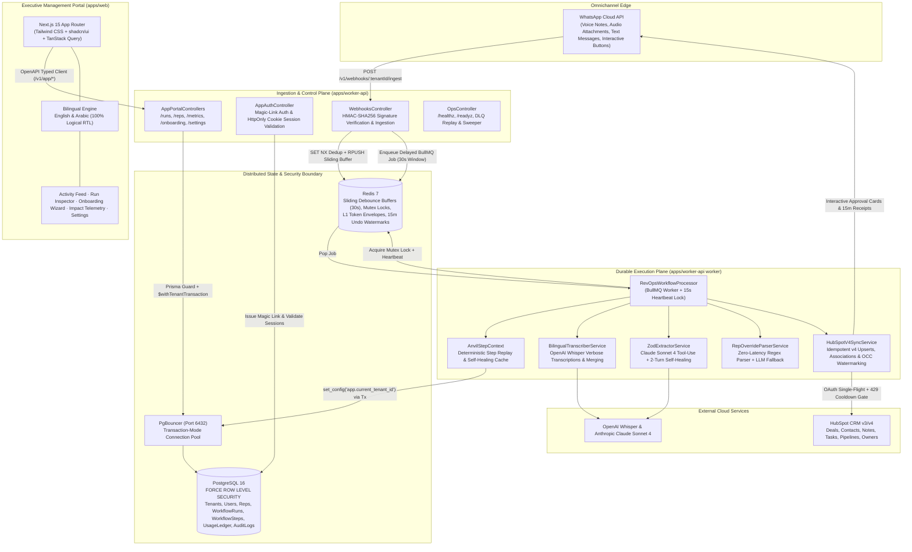
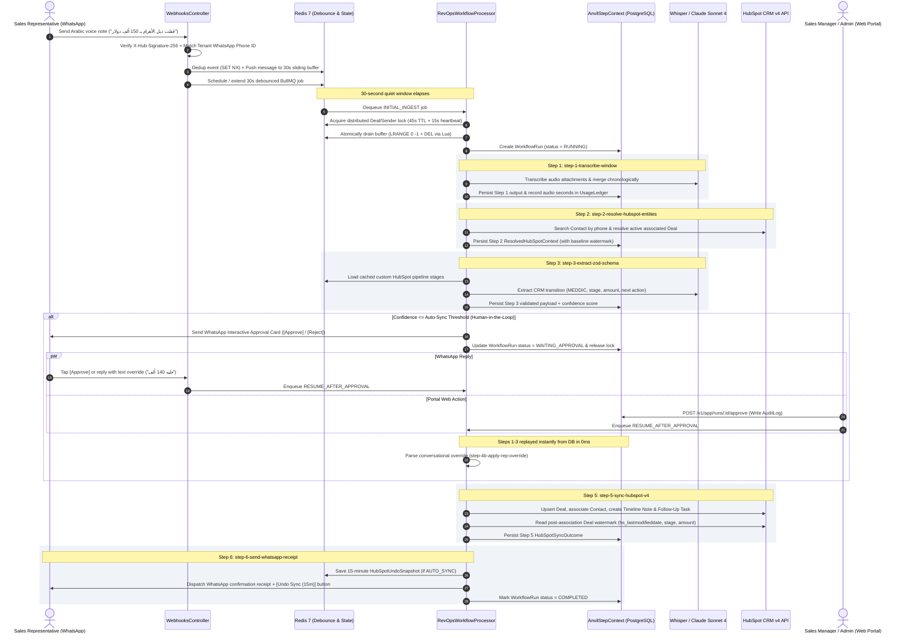
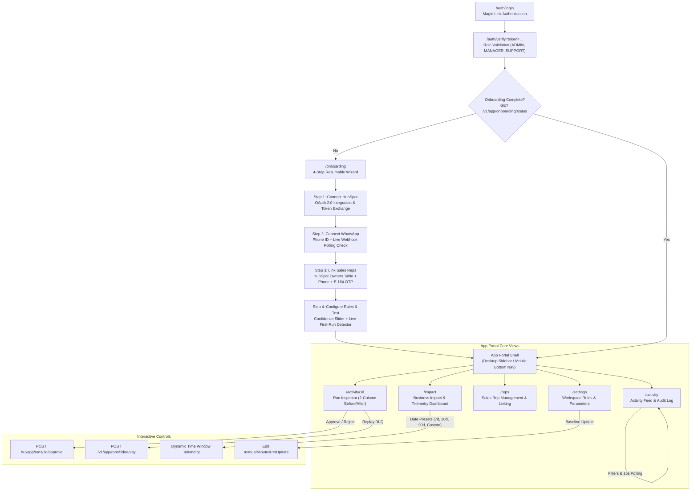
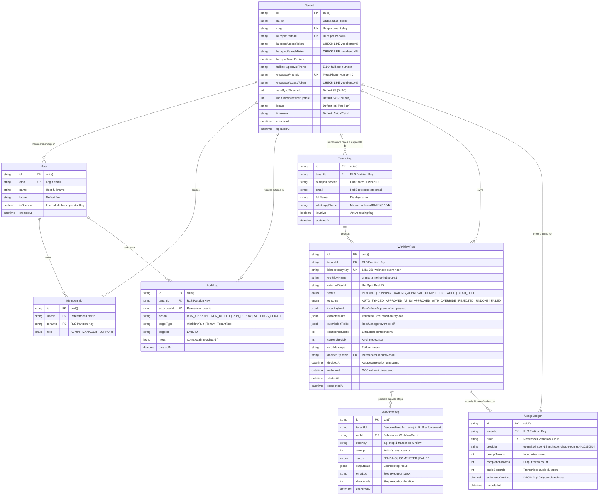
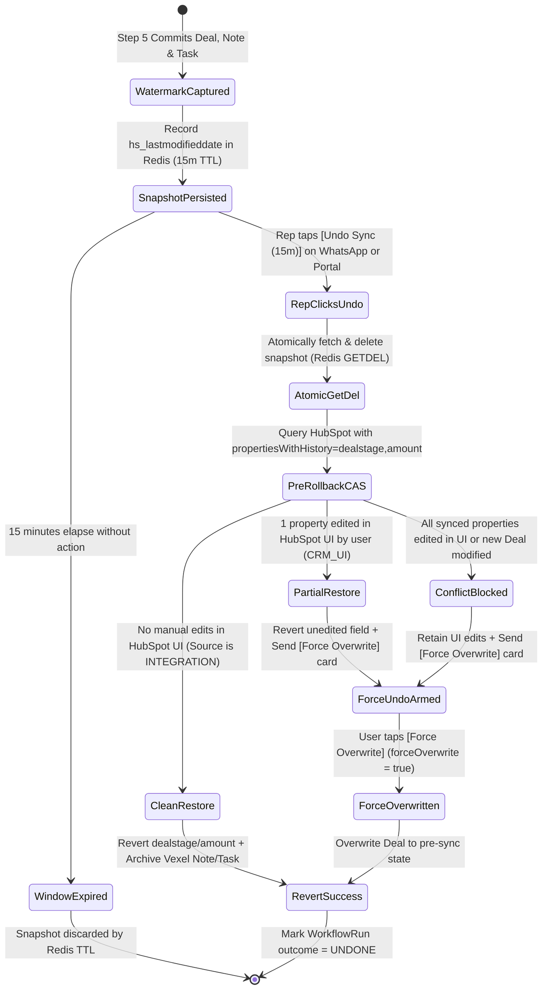

# Vexel — Autonomous Omnichannel-to-HubSpot RevOps Engine

Vexel is an enterprise multi-tenant Revenue Operations (RevOps) execution engine and management portal. It transforms unstructured bilingual (Arabic/English) WhatsApp voice notes and text conversations from field sales reps into validated, idempotent HubSpot CRM v4 state transitions.

Built with an event-driven durable step runner (`@vexel/anvil-engine`), Vexel enforces hardware-grade envelope encryption (`AES-256-GCM`) for OAuth credentials at rest, PostgreSQL 16 Row-Level Security (RLS) pinned over PgBouncer transaction-mode connections, human-in-the-loop WhatsApp and web approvals, conversational sales rep overrides, a 15-minute Two-Phase Optimistic Concurrency Control (OCC) rollback saga, and a modern bilingual Next.js web application with full RTL layout support.

---

## Table of Contents

1. [Visual Project Architecture](#1-visual-project-architecture)
   - [1.1 End-to-End System Architecture](#11-end-to-end-system-architecture)
   - [1.2 Execution Pipeline Sequence (Anvil Durable Steps)](#12-execution-pipeline-sequence-anvil-durable-steps)
   - [1.3 Web Portal Information Architecture & UX Flow](#13-web-portal-information-architecture--ux-flow)
   - [1.4 Multi-Tenant Database ERD & Security Boundary](#14-multi-tenant-database-erd--security-boundary)
   - [1.5 Two-Phase OCC & 15-Minute Undo State Machine](#15-two-phase-occ--15-minute-undo-state-machine)
2. [Monorepo Package Topology](#2-monorepo-package-topology)
3. [Durable Step Execution Pipeline](#3-durable-step-execution-pipeline)
4. [Web Application (`apps/web`)](#4-web-application-appsweb)
   - [4.1 Architecture & Design System](#41-architecture--design-system)
   - [4.2 Core Views & Capabilities](#42-core-views--capabilities)
   - [4.3 Dual-Locale i18n & Logical RTL Engineering](#43-dual-locale-i18n--logical-rtl-engineering)
5. [Two-Phase OCC & 15-Minute Undo Saga](#5-two-phase-occ--15-minute-undo-saga)
6. [Multi-Tenant Data Model & PostgreSQL Row-Level Security](#6-multi-tenant-data-model--postgresql-row-level-security)
7. [Cryptographic Envelope Specification](#7-cryptographic-envelope-specification)
8. [Redis Keyspace & Concurrency Primitives](#8-redis-keyspace--concurrency-primitives)
9. [HTTP & Portal API Reference](#9-http--portal-api-reference)
   - [9.1 Tenant-Scoped App Portal API (`/v1/app`)](#91-tenant-scoped-app-portal-api-v1app)
   - [9.2 Omnichannel Webhooks API (`/v1/webhooks`)](#92-omnichannel-webhooks-api-v1webhooks)
   - [9.3 HubSpot Onboarding & OAuth API (`/v1/hubspot`)](#93-hubspot-onboarding--oauth-api-v1hubspot)
   - [9.4 Operations & Dead-Letter Queue API (`/v1/ops`)](#94-operations--dead-letter-queue-api-v1ops)
10. [Realistic Demo Seed Dataset (`pnpm db:seed`)](#10-realistic-demo-seed-dataset-pnpm-dbseed)
11. [Environment Configuration](#11-environment-configuration)
12. [Local Development & Verification](#12-local-development--verification)

---

## 1. Visual Project Architecture

### 1.1 End-to-End System Architecture



---

### 1.2 Execution Pipeline Sequence (Anvil Durable Steps)



---

### 1.3 Web Portal Information Architecture & UX Flow



---

### 1.4 Multi-Tenant Database ERD & Security Boundary



---

### 1.5 Two-Phase OCC & 15-Minute Undo State Machine



---

## 2. Monorepo Package Topology

Vexel is structured as a `pnpm` monorepo:

| Package / App | Directory | Tech Stack | Role & Responsibility |
| :--- | :--- | :--- | :--- |
| **`web`** | `apps/web` | Next.js 15 (App Router), React 19, TypeScript, Tailwind CSS, shadcn/ui, TanStack Query, next-intl | Multi-tenant bilingual executive portal. Features full RTL support, magic-link auth, 4-step onboarding wizard, live-polling activity feed, two-column run inspector, and impact analytics with SVG charts. |
| **`worker-api`** | `apps/worker-api` | NestJS 11, BullMQ 5, TypeScript, Swagger / OpenAPI 3.1 | Dual-role ingestion API and durable execution worker. Houses omnichannel webhook handlers, OAuth consent endpoints, app portal endpoints (`/v1/app/*`), and the RevOps BullMQ workflow processor. |
| **`@vexel/anvil-engine`** | `packages/anvil-engine` | TypeScript | Deterministic step execution engine (`AnvilStepContext`). Executes external HTTP I/O strictly outside database transactions, caches intermediate outputs in `WorkflowStep`, and manages cache invalidation. |
| **`@vexel/crm-hubspot`** | `packages/crm-hubspot` | TypeScript | Encrypted OAuth token manager (`EnvelopeCryptoService`), single-flight token refresher, rate-limit-aware HTTP client with 429 backoff, entity resolver, owner router, WhatsApp approval cards, and idempotent v4 sync + Two-Phase OCC rollback saga. |
| **`@vexel/extractor`** | `packages/extractor` | TypeScript, Zod | Bilingual Whisper audio transcriber (`OPENAI_AUDIO_MODEL`), dynamic HubSpot pipeline stage cache, strict Zod schema generator, self-healing Claude Sonnet 4 extractor (`ANTHROPIC_MODEL`) with 2-turn diagnostic repair, and zero-token regex override parser. |
| **`@vexel/database`** | `packages/database` | Prisma 7, PostgreSQL 16, PgBouncer | PostgreSQL database schema, migrations, `FORCE ROW LEVEL SECURITY` policies, `AsyncLocalStorage` tenant context (`TenantContext`), transaction-pinned `$withTenantTransaction`, and plaintext token write guards. |

---

## 3. Durable Step Execution Pipeline

Every inbound voice note or WhatsApp batch is executed through a sequence of durable, deterministic Anvil steps:

| Step Key | Input Source | External I/O | Self-Healing / Failure Mode |
| :--- | :--- | :--- | :--- |
| `step-1-transcribe-window` | `inputPayload.messages` | Meta Media API + Whisper verbose JSON | Retries via BullMQ exponential backoff. Merges multiple voice notes and text fragments chronologically; logs audio seconds to `UsageLedger`. |
| `step-2-resolve-hubspot-entities` | `senderPhone` | HubSpot `/crm/v3/objects/contacts/search` + v4 Deal associations | Locates Contact by E.164 phone and finds active associated Deal. Falls back to Deal owner over Contact owner. |
| `step-3-extract-zod-schema` | Transcript + `ResolvedHubSpotContext` + `TenantDealStage[]` | Anthropic Claude (`ANTHROPIC_MODEL`, default `claude-sonnet-4-20250514`) tool-use | Stage 1 deterministic sanitizer + Stage 2 two-turn Zod diagnostic feedback loop. Validates MEDDIC qualifiers, deal stage transitions, amounts, and follow-ups. |
| `step-4-dispatch-approval-prompt` | `CrmTransitionPayload` (when `confidenceScore <= threshold`) | Meta Graph API `/messages` (Interactive Button Card) | Dispatches interactive card to Deal owner's WhatsApp or `tenant.fallbackApprovalPhone`. Pauses run in `WAITING_APPROVAL`. |
| `step-4b-apply-rep-override` | `rawRepOverrideText` + existing `CrmTransitionPayload` | Regex parser (<1ms) or Claude fallback | Normalizes Egyptian and Gulf Arabic numbers, shorthand multipliers (`42k`, `1.5m`), currencies, and fuzzy pipeline stages. |
| `step-5-sync-hubspot-v4` | Final `CrmTransitionPayload` + `ResolvedHubSpotContext` | HubSpot v3/v4 Deals, Notes, Tasks, Associations | Deduplicates Notes and Tasks via deterministic `[vexel_run_id:{runId}]` tags. Handles stale deal stages by invalidating stage caches and evicting Steps 3–5. Captures post-association watermark. |
| `step-6-send-whatsapp-receipt` | `HubSpotSyncOutcome` | Meta Graph API `/messages` | Stores 15-minute `HubSpotUndoSnapshot` in Redis (for `AUTO_SYNC` runs) and dispatches deep-linked receipt with `[Undo Sync (15m)]` button. |
| `step-7-rollback-hubspot-sync` | `HubSpotUndoSnapshot` (`ROLLBACK_AUTO_SYNC`) | HubSpot v3 Deals (`propertiesWithHistory`) + Notes/Tasks archive | Executes Two-Phase OCC CAS inspection before restoring previous deal fields or archiving newly created deals. |

---

## 4. Web Application (`apps/web`)

`apps/web` provides RevOps administrators, sales managers, and support teams with a full-featured management portal.

### 4.1 Architecture & Design System

- **Framework**: Next.js 15 App Router with React 19 and TypeScript.
- **Styling**: Tailwind CSS with shadcn/ui components.
- **RTL-First Engineering**: Built with **100% logical directional utilities** (`ms-`, `me-`, `ps-`, `pe-`, `text-start`, `border-s-`, `border-e-`). Zero physical `ml-`, `mr-`, `pl-`, `pr-`, `text-left`, or `text-right` classes exist in the codebase.
- **Typography**: Dual-font typography using **Cairo** for Arabic and **Inter** for English.
- **Data Layer**: Generated typed API client (`apps/web/src/lib/api/openapi.ts`) consumed via TanStack Query hooks (`useWorkflowRuns`, `useWorkflowRun`, `useAppMetrics`, `useOnboardingStatus`, `useTenantReps`).

### 4.2 Core Views & Capabilities

1. **Magic-Link Authentication (`/auth/login`, `/auth/verify`)**:
   - Passwordless email login that issues single-use 15-minute magic links (`vexel:magic:<sha256>`).
   - Upon verification, the server sets an opaque **`HttpOnly; Path=/; SameSite=Lax; Secure` cookie** (`vexel_session`) backed by SHA-256 hashed session records in Redis (`vexel:sess:<sha256>`). Zero session tokens are stored in `localStorage` or `sessionStorage`.
   - Evaluates user tenant memberships and provisions role-based access (`ADMIN`, `MANAGER`, `SUPPORT`).
2. **4-Step Resumable Onboarding Wizard (`/onboarding`)**:
   - Automatically queries `GET /v1/app/onboarding/status` to resume exactly where the workspace left off.
   - **Step 1 (HubSpot)**: One-click OAuth install button and connected portal status badge.
   - **Step 2 (WhatsApp)**: Phone number ID and Meta token setup with a live polling indicator that automatically advances upon receiving a test webhook.
   - **Step 3 (Sales Reps)**: Synced HubSpot owners table with client-side E.164 phone validation, instant OTP dispatch, and linked status indicators.
   - **Step 4 (Rules & Test)**: Confidence auto-sync slider with plain-language explanations, fallback phone number input, and a live listening screen that completes onboarding when the first sales run appears.
3. **Activity Feed (`/activity`)**:
   - Filterable runs list by status (`WAITING_APPROVAL`, `COMPLETED`, `FAILED`, `DEAD_LETTER`), rep, and date range.
   - Infinite cursor pagination, status badges, confidence chips, relative timestamps, and automatic polling every 15 seconds.
   - High-density rows displaying sales rep name, deal ID, and a one-line change summary.
4. **Run Inspector (`/activity/:id`)**:
   - **Desktop 2-column layout** (responsive stacked view on mobile).
   - **Left Column**: Full voice/text transcript with contextual keyword highlights matching extracted CRM entities.
   - **Right Column**: "What Vexel Changed" before/after diff cards, confidence meter, and step execution timeline with durations.
   - **Action Bar**: Open in HubSpot, Approve / Reject (for `WAITING_APPROVAL` runs), Replay (for `FAILED` runs), and interactive Undo (when permitted within the 15-minute window).
5. **Business Impact & Telemetry (`/impact`)**:
   - **Dynamic Date Range Picker**: 7-day, 30-day, 90-day presets and custom date pickers.
   - **6 Executive KPI Cards**: Total Runs, Auto-Sync Rate, Approval Rate, Override Edit Rate, Estimated Time Saved (with direct link to edit the baseline in Settings), and Cost Per Run.
   - **Handcrafted SVG Stacked Daily Chart**: Daily runs split by outcome (`autoSynced`, `approvedAsIs`, `approvedWithOverride`, `rejected`, `failed`) with hover tooltips and accessible keyboard navigation.
   - **Team Performance Table**: Sales representative activity breakdown with avatar initials, total runs, approval rates, and confidence badges.
6. **Workspace Settings (`/settings`)**:
   - Configuration panel to update `autoSyncThreshold` and `manualMinutesPerUpdate` (1–120 minutes) with instant cache invalidation.

### 4.3 Dual-Locale i18n & Logical RTL Engineering

Vexel supports both English (`en`) and Arabic (`ar`) locales out of the box via `next-intl`:

- Layout automatically applies `dir="rtl"` and `lang="ar"` on `/[locale]` routes.
- Component tests (`apps/web/src/__tests__/rtl-smoke.spec.ts`) verify that Arabic routes correctly render the RTL DOM tree and all logical spacing rules.

---

## 5. Two-Phase OCC & 15-Minute Undo Saga

Updating a Deal in HubSpot and associating Notes or Tasks naturally advances `hs_lastmodifieddate` by 500ms–2,500ms. To prevent false-positive conflicts while preserving legitimate human edits made directly in the HubSpot UI, Vexel implements Two-Phase OCC:

1. **Phase 1 (Post-Association Watermark Capture)**: Upon completion of `step-5-sync-hubspot-v4`, Vexel reads the Deal's post-sync `hs_lastmodifieddate`, `dealstage`, and `amount`, writing them to Redis (`vexel:undo:{tenantId}:{runId}`).
2. **Phase 2 (Pre-Rollback CAS Inspection)**: When a rep clicks `[Undo Sync (15m)]`, Vexel pops the snapshot via Redis `GETDEL` and inspects `propertiesWithHistory=dealstage,amount`:

| Scenario During 15m Window | `hs_lastmodifieddate` | `propertiesWithHistory` Source | Deal Rollback Action (`dealAction`) | Timeline Note & Task | Follow-Up Card |
| :--- | :--- | :--- | :--- | :--- | :--- |
| **No concurrent edits** | `<= syncedDealLastModifiedMs + 3000ms` | `INTEGRATION` | `RESTORED_PREVIOUS_STATE` (or `ARCHIVED_NEW_DEAL`) | Archived (`DELETE`) | Confirmation notice |
| **Rep edited `dealstage` in UI** | `> watermark` | `CRM_UI` on `dealstage` | `PARTIAL_RESTORE_SKIPPED_EDITED_FIELDS` (reverts `amount`, keeps UI `dealstage`) | Archived (`DELETE`) | Interactive `[Force Overwrite]` button |
| **Rep edited all properties in UI** | `> watermark` | `CRM_UI` on all fields | `CONFLICT_PRESERVED_MANUAL_EDIT` (keeps UI changes) | Archived (`DELETE`) | Interactive `[Force Overwrite]` button |
| **Rep clicks `[Force Overwrite]`** | Any | Any (`forceOverwrite: true`) | `FORCE_OVERWRITTEN` (unconditionally restores prior state) | Already archived | Confirmation notice |

---

## 6. Multi-Tenant Data Model & PostgreSQL Row-Level Security

Multi-tenancy is enforced at three defense-in-depth layers:

1. **PostgreSQL `FORCE ROW LEVEL SECURITY`**:
   - Enabled across `Tenant`, `User`, `Membership`, `TenantRep`, `WorkflowRun`, `WorkflowStep`, `UsageLedger`, and `AuditLog`.
   - Every policy guarantees:
     ```sql
     NULLIF(current_setting('app.bypass_rls', true), '') = 'on'
     OR "tenantId" = NULLIF(current_setting('app.current_tenant_id', true), '')
     ```
2. **PgBouncer Transaction-Mode Pinning (`$withTenantTransaction`)**:
   - Because PgBouncer transaction pooling reuses connections across requests, session-level `SET` calls can leak tenant boundaries.
   - `@vexel/database` runs all queries within interactive transactions executing `SELECT set_config('app.current_tenant_id', $1, true)` (`is_local = true`).
3. **Application-Layer Tenant Guard (`tenant-rls.guard.ts`)**:
   - Automatically injects `tenantId` from `TenantContext` (`AsyncLocalStorage`) into Prisma query filters.
   - Throws `MissingTenantContextError` if executed outside tenant context, and `CrossTenantAccessError` if an entity belongs to another tenant.

---

## 7. Cryptographic Envelope Specification

All third-party OAuth credentials and sensitive access tokens are sealed prior to database or cache persistence using `EnvelopeCryptoService`:

```text
vexel:enc:<kekVersion>:<wrappedDekBundleBase64Url>:<cipherBundleBase64Url>
```

- **`kekVersion`**: Active 256-bit Key Encryption Key identifier (`v1`, `v2`, ...).
- **`wrappedDekBundle`**: `IV (12B) || AuthTag (16B) || WrappedDEK (32B)` encrypted with `AES-256-GCM` under the Master KEK.
- **`cipherBundle`**: `IV (12B) || AuthTag (16B) || Ciphertext (NB)` encrypted with `AES-256-GCM` under the random one-time DEK.
- **GCM AAD**: Bound to `UTF-8("${tenantId}:${purpose}")`, mathematically preventing cross-tenant or cross-column ciphertext transplantation.
- **Prisma & DB Guards**: Prisma write hooks throw `UnencryptedTokenWriteError` if unsealed tokens are saved; PostgreSQL `CHECK` constraints reject any write not starting with `vexel:enc:v`.

---

## 8. Redis Keyspace & Concurrency Primitives

| Key Pattern | Data Structure | TTL | Purpose |
| :--- | :--- | :--- | :--- |
| `vexel:dedup:{tenantId}:{sha256}` | `STRING` | `24h` | Webhook event deduplication (`SET NX EX 86400`). |
| `vexel:buf:{tenantId}:{senderPhone}` | `LIST` | `1h` | Sliding 30-second message buffer; drained atomically via Lua. |
| `vexel:lock:{tenantId}:{entityKey}` | `STRING` | `45s` | Distributed deal mutex; renewed every 15s and released via owner-checked Lua. |
| `vexel:hs:token:{tenantId}` | `STRING` | `expiresIn - 120s` | L1 cache for sealed `vexel:enc:...` HubSpot access tokens. |
| `vexel:hs:oauth-lock:{tenantId}` | `STRING` | `15s` | Single-flight mutex preventing concurrent OAuth refresh stampedes. |
| `vexel:hs:cooldown:{tenantId}` | `STRING` | Dynamic (`retryAfterMs`) | Tenant-wide rate-limit backpressure gate armed on HTTP `429`. |
| `vexel:pipelines:{tenantId}:{pipelineId}` | `STRING` | `6h` | Cached custom HubSpot deal stages and win probabilities. |
| `vexel:owners:{tenantId}` | `HASH` | `12h` | Cached mapping of `hubspotOwnerId` to name, email, and WhatsApp phone. |
| `vexel:rep-link-otp:{tenantId}:{e164Phone}` | `STRING` | `10m` | SHA-256 OTP hash and attempt counter (max 5) for rep self-linking. |
| `vexel:magic:{sha256}` | `STRING` | `15m` | Single-use SHA-256 hashed magic-link token consumed atomically via `GETDEL`. |
| `vexel:sess:{sha256}` | `STRING` | `7d` | Server-side session record bound to the `vexel_session` `HttpOnly` cookie (only SHA-256 token hash stored). |
| `vexel:undo:{tenantId}:{runId}` | `STRING` | `15m` | Stores `HubSpotUndoSnapshot` post-association OCC watermarks; popped via `GETDEL`. |

---

## 9. HTTP & Portal API Reference

Vexel exposes a complete OpenAPI 3.1 specification at [`apps/worker-api/src/openapi/vexel-app-api.openapi.json`](./apps/worker-api/src/openapi/vexel-app-api.openapi.json).

### 9.1 Tenant-Scoped App Portal API (`/v1/app`)

All portal endpoints run behind the session auth guard, injecting the authenticated tenant and user context.

| Method | Endpoint | Allowed Roles | Description |
| :--- | :--- | :--- | :--- |
| `GET` | `/v1/app/me` | All | Returns current user profile, memberships, active tenant, and assigned role. |
| `GET` | `/v1/app/runs` | All | Cursor-paginated runs list with filters (`status`, `repId`, `from`, `to`, `cursor`, `limit`). |
| `GET` | `/v1/app/runs/:id` | All | Detailed run view: step execution timeline, transcript, before/after diffs, and undo status. |
| `POST` | `/v1/app/runs/:id/approve` | `ADMIN`, `MANAGER` | Resumes a `WAITING_APPROVAL` run into HubSpot sync; writes an `AuditLog` entry. |
| `POST` | `/v1/app/runs/:id/reject` | `ADMIN`, `MANAGER` | Marks run as `REJECTED`; writes an `AuditLog` entry. |
| `POST` | `/v1/app/runs/:id/replay` | `ADMIN`, `MANAGER` | Re-queues a `FAILED` or `DEAD_LETTER` run from its last completed Anvil step. |
| `GET` | `/v1/app/reps` | All | Lists sales reps. Phone numbers are masked (`+2010****567`) unless requester is `ADMIN`. |
| `POST` | `/v1/app/reps` | `ADMIN`, `MANAGER` | Registers a sales rep with an E.164 WhatsApp number. |
| `PATCH` | `/v1/app/reps/:id` | `ADMIN`, `MANAGER` | Updates sales rep details or toggles `isActive` status. |
| `POST` | `/v1/app/reps/:id/send-link-code` | `ADMIN`, `MANAGER` | Dispatches a 6-digit WhatsApp OTP link verification code to the rep. |
| `GET` | `/v1/app/metrics` | All | Telemetry data (`from`, `to`): runs by outcome, auto-sync rate, approval rate, edit rate, average confidence, estimated minutes saved, cost per run, daily buckets, and rep activity. |
| `GET` | `/v1/app/onboarding/status` | All | Onboarding health: HubSpot connected, WhatsApp connected, linked reps count, first run received. |
| `PATCH` | `/v1/app/settings` | `ADMIN` | Updates `autoSyncThreshold`, `manualMinutesPerUpdate`, and `fallbackApprovalPhone`. |

### 9.2 Omnichannel Webhooks API (`/v1/webhooks`)

| Method | Endpoint | Auth | Description |
| :--- | :--- | :--- | :--- |
| `GET` | `/v1/webhooks/:tenantId/ingest` | Verify Token | WhatsApp webhook handshake verification. |
| `POST` | `/v1/webhooks/:tenantId/ingest` | `X-Hub-Signature-256` | Inbound WhatsApp events: audio voice notes, text messages, interactive button taps, and delivery receipts. |
| `POST` | `/v1/webhooks/approval-callback` | Internal API Key | Programmatic webhook to resume paused approval workflows. |

### 9.3 HubSpot Onboarding & OAuth API (`/v1/hubspot`)

| Method | Endpoint | Auth | Description |
| :--- | :--- | :--- | :--- |
| `GET` | `/v1/hubspot/install` | Public Redirect | Initiates HubSpot OAuth 2.0 consent with Deals, Contacts, Owners, and Timeline scopes. |
| `GET` | `/v1/hubspot/callback` | OAuth Code | Exchanges auth code, seals tokens with `AES-256-GCM`, warms owner caches, and schedules sync jobs. |
| `POST` | `/v1/hubspot/disconnect` | Internal API Key | Purges tenant OAuth tokens and clears cached metadata. |

### 9.4 Operations & Dead-Letter Queue API (`/v1/ops`)

| Method | Endpoint | Auth | Description |
| :--- | :--- | :--- | :--- |
| `GET` | `/healthz` | None | Liveness check reporting uptime and mounted process role. |
| `GET` | `/readyz` | None | Readiness probe checking PostgreSQL, Redis, and BullMQ queue depths. |
| `GET` | `/v1/ops/tenants/:tenantId/dlq` | Internal API Key | Lists dead-lettered and failed workflow runs. |
| `POST` | `/v1/ops/tenants/:tenantId/dlq/:runId/replay` | Internal API Key | Re-executes dead-lettered run from the last successful step. |
| `POST` | `/v1/ops/tenants/:tenantId/sweep` | Internal API Key | Sweeper job that expires stale approval runs (48h) and redacts PII voice payloads (90d). |

---

## 10. Realistic Demo Seed Dataset (`pnpm db:seed`)

Vexel includes a seed generator ([`packages/database/prisma/seed-demo.ts`](./packages/database/prisma/seed-demo.ts)) that provisions a demonstration workspace:

```bash
pnpm db:seed
```

### Seeded Workspace Data:
- **Tenant**: `tenant_demo_mena` (`Acme MENA Corp`, `ar` locale, Cairo timezone, 85% auto-sync threshold, 6 min baseline).
- **Users**:
  - Admin: `karim@vexel-demo.com` (`ADMIN`)
  - Manager: `sarah@vexel-demo.com` (`MANAGER`)
  - Support: `tariq@vexel-demo.com` (`SUPPORT`)
- **Sales Representatives**: 4 reps with verified E.164 phone numbers across Egypt, UAE, and Saudi Arabia.
- **12 Workflow Runs**:
  - Realistic Egyptian & Gulf Arabic voice notes and English sales summaries.
  - Full distribution of outcomes: `AUTO_SYNCED`, `APPROVED_AS_IS`, `APPROVED_WITH_OVERRIDE`, `UNDONE`, `FAILED`, and `WAITING_APPROVAL`.
  - Realistic step timelines (`WorkflowStep`) and AI cost entries (`UsageLedger`).

---

## 11. Environment Configuration

Copy `.env.example` to `.env` and configure the following variables:

| Variable | Description |
| :--- | :--- |
| `PORT` | API server listen port (default: `3001`). |
| `VEXEL_PROCESS_ROLE` | Process mode: `api` (HTTP only), `worker` (BullMQ worker), or `both`. |
| `DATABASE_URL` | PgBouncer transaction-pooled PostgreSQL connection URL (port `6432`). |
| `DIRECT_URL` | Direct PostgreSQL connection URL for Prisma migrations (port `5432`). |
| `REDIS_URL` | Redis 7 connection string (`redis://localhost:6379`). |
| `VEXEL_ACTIVE_KEK_VERSION` | Active KEK version identifier (`v1`). |
| `VEXEL_KEK_V1` | 64-hex-character (32-byte) Master Key Encryption Key. |
| `VEXEL_APPROVAL_HMAC_SECRET` | Secret key signing WhatsApp interactive card payloads. |
| `VEXEL_INTERNAL_API_KEY` | Secret token verified against `x-vexel-api-key`. |
| `META_APP_SECRET` | Meta Application Secret for WhatsApp webhook signature validation. |
| `META_WEBHOOK_VERIFY_TOKEN` | Verification token verified during WhatsApp webhook registration. |
| `OPENAI_API_KEY` | OpenAI API key for Whisper audio transcription. |
| `OPENAI_AUDIO_MODEL` | Configurable OpenAI transcription model (default: `whisper-1`). |
| `ANTHROPIC_API_KEY` | Anthropic API key for Claude structured extraction. |
| `ANTHROPIC_MODEL` | Configurable Anthropic extraction model (default: `claude-sonnet-4-20250514`). |
| `NEXT_PUBLIC_API_URL` | Worker API backend URL for `apps/web` (default: `http://localhost:3001`). |

---

## 12. Local Development & Verification

### 12.1 Prerequisites
- Node.js `>= 22`
- `pnpm` `v11.24.0` (via Corepack: `corepack enable`)
- Docker & Docker Compose (for PostgreSQL 16, PgBouncer, and Redis 7)

### 12.2 Local Setup

```bash
# 1. Install all monorepo dependencies
pnpm install

# 2. Start PostgreSQL, PgBouncer, and Redis containers
docker compose up -d vexel-postgres vexel-pgbouncer vexel-redis

# 3. Generate Prisma client & apply migrations
pnpm db:generate
pnpm db:migrate

# 4. (Optional) Seed realistic demo tenant & runs
pnpm db:seed

# 5. Start Worker API in development mode
pnpm --filter worker-api dev

# 6. Start Web Portal in development mode (in a separate terminal)
pnpm --filter web dev
```

The Web Portal will be available at `http://localhost:3000` (English at `/en/activity`, Arabic at `/ar/activity`).

### 12.3 Running the Test Suite & Typechecks

Vexel maintains strict type safety and high unit test coverage across all packages:

```bash
# Run all 28 Vitest unit test suites (139 tests)
pnpm test

# Run Vitest in interactive watch mode
pnpm test:watch

# Verify TypeScript typechecks across the stack
pnpm --filter worker-api exec tsc --noEmit
pnpm --filter web exec tsc --noEmit
pnpm --filter @vexel/database exec tsc --noEmit
```
